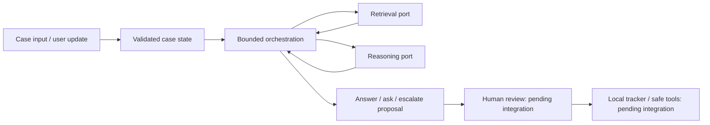

# Architecture: first core foundation

Status: implemented foundation on the agent-core branch; team-wide integration choices remain proposals. Domain proposal: Streamlit Session State, Widgets, and callback/rerun. The original `plan/` stays intact.

The core coordinates evidence and produces a structured proposal. Retrieval, model access, durable storage, and UI connect through shared contracts rather than importing one another's implementation.

## Current behavior

The normal path retrieves evidence and requests a structured decision. A request for more evidence may trigger one refinement round; the run then stops with an answer, a targeted question, or an escalation. Each invocation has hard ceilings of 2 model attempts, 2 retrieval rounds, 2 queries per round, and 8 steps. Retries after malformed output consume the same allowance; they do not create a fresh allowance. Limits apply per invocation until the tracker persists progress across resumes.

Refinement analyzes only the latest `EvidenceBundle`; the engine does not implicitly accumulate earlier hits. The retriever may carry forward relevant initial hits into that bundle. The core validates referenced evidence and stops safely on adapter errors or exhausted limits. Citation ID validation proves that the referenced locator is present; it does not prove semantic faithfulness. Demo adapters are deterministic and have no network access.

`SupportEngine.run(case, user_message)` returns a `RunResult`; the constructor accepts an optional current-revision callback for freshness checks. The caller supplies the authoritative current `CaseState`, including new or corrected facts; this foundation does not extract facts automatically. Persistence and execution authorization need the real integrations. All returned drafts await separate human review; a draft is not proof of an executed action or a solved case.

There is no paid model client, real retrieval index, durable tracker, or backend connection to Streamlit in this foundation. A scripted response only proves that the orchestration and contracts run together; it does not prove answer quality.

## Four ownership boundaries

| Owner | Owns | Integration agreement |
| --- | --- | --- |
| Agent core | `contracts.py`, `orchestration/`, `reasoning/`, `testing/`, `cli.py`, `demo.py`; reserved `llm/` | Defines shared contracts; model port: `Reasoner.analyze(case, user_message, evidence)` → `AnalysisResult` or a JSON object/string |
| Data/RAG | `data/`, collection scripts; proposed `ingestion/`, `retrieval/` | `Retriever.search(RetrievalRequest)` → `EvidenceBundle`; preserves URL, source section, version/commit, and chronology |
| Tracker/tools | Proposed `tracker/`, `tools/` | Persists case state; validates exact approval and current revision; prevents duplicate execution |
| UI/evaluation | `app.py`; proposed `evaluation/` | Calls the core instead of recreating policy; exposes proposals and review; owns dev/test protocol |

Python module paths are relative to `src/agent_app/`. Both ports are defined in `orchestration/ports.py`, and their returned values are validated by the engine. Tests follow the corresponding owner. `pyproject.toml`, `uv.lock`, README, and shared contracts need coordinated review. Proposed paths are reserved boundaries, not evidence that those implementations already exist.

## Integration requirements

1. Retrieval must use the fixed local snapshot during evaluation. A closed issue is not automatically a verified solution. Metadata must distinguish docs, issues, comments, and release notes.
2. The real gateway must validate structured output, count requests/tokens, record actual cost without secrets, and check the shared budget before a call. Unknown price must not silently become zero.
3. The tracker must bind approval to case ID, revision, and exact proposal content; editing creates a fresh proposal. Check case freshness again before execution. A persisted idempotency key and outcome lookup are needed for retries and interrupted execution.
4. UI must display known facts, evidence, unknowns, and the next step. It must distinguish a draft from an executed action and a pending case from a solved problem.
5. Evaluation must use 15 dev + 15 test cases, including at least 10 multi-turn scenarios, half in test. Hold out each case's full discussion and outcome from retrieval, including duplicates and direct-answer leakage.

## Decision record

Use plain Python orchestration plus Pydantic contracts for this first slice. The project brief allows framework choice; adopting LangGraph is not a requirement. This keeps offline tests and module handoffs easy while real adapters are being built. Revisit only when a concrete workflow benefits from another framework; compare quality, complexity, and cost before changing the team architecture.

Adversarial Testing is a proposed bonus after the main workflow works. Basic handling of untrusted inputs, tool failure, corrections, and repeated actions is already required by the main brief; a bonus needs a systematic challenge set and measured improvement, with mentor agreement.
