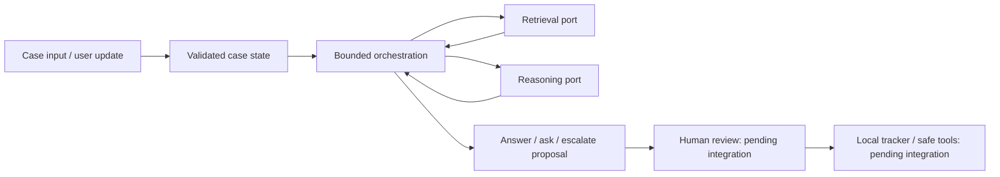

# Architecture: first core foundation

Status: implemented foundation on the agent-core branch; team-wide integration choices remain proposals. Domain proposal: Streamlit Session State, Widgets, and callback/rerun. The original `plan/` stays intact.

The core coordinates evidence and produces a structured proposal. Retrieval, model access, durable storage, and UI connect through shared contracts rather than importing one another's implementation.

The optional `evidence_scope="exact_user_version"` engine mode filters explicitly
versioned hits against the active user version before each reasoning attempt.
Default `all` preserves historical comparison sources. Unknown metadata,
same-version contradictions and semantic claim support still require review.
The pure `prepare_version_reply` adapter recognizes a standalone release reply
only for the registered canonical pending question; the additive
`prepare_approved_version_reply` handles its tracker-bound approved record after
the pending ID clears. Both return a `UserTurn`,
then the existing transition/tracker transaction boundary applies. Neither
capability introduces another agent, changes the ports or executes an action.
See the [controlled comparison and tradeoffs](controlled-core-v8.fa.md).

The optional `GroundedReasoner` implements the same reasoning port through an
additive `GroundedPlanner` port. The planner selects references/routes; the core
renders full attributed quotations, active user reports and registered questions.
Gap/conflict metadata is caller-curated, with no automatic semantic detector.
`MetisGroundedPlanner` reuses the existing single gateway and accounting path.
Whole-proposal review packets bind the exact case, latest sources and complete
proposal but grant no approval or execution. See [contracts and handoffs](extractive-core.md)
and [controlled V9 results](controlled-core-v9.fa.md). Default behavior stays unchanged.

## Current behavior

The normal path retrieves evidence and requests a structured decision. A request for more evidence may trigger one refinement round; the run then stops with an answer, a targeted question, or an escalation. Each invocation has hard ceilings of 2 model attempts, 2 retrieval rounds, 2 queries per round, and 8 steps. Retries after malformed output consume the same allowance; they do not create a fresh allowance. Limits apply per invocation until the tracker persists progress across resumes.

Refinement analyzes only the latest `EvidenceBundle`; the engine does not implicitly accumulate earlier hits. The retriever may carry forward relevant initial hits into that bundle. The core validates referenced evidence and stops safely on adapter errors or exhausted limits. Citation ID validation proves that the referenced locator is present; it does not prove semantic faithfulness. Demo adapters are deterministic and have no network access.

`SupportEngine.run(case, user_message)` returns a `RunResult`; the constructor accepts an optional current-revision callback for freshness checks. The caller supplies the authoritative current `CaseState`. `propose_user_turn(case, turn)` prepares explicit user facts and corrections as an uncommitted next-state candidate. It preserves attribution history, invalidates prior evidence conclusions when knowledge changes or a novel normalized check is reported, and clears unscoped checks on actual corrections or environment switches. New check-only reports preserve user facts/check history while retiring prior evidence conclusions; equivalent repeated checks preserve those conclusions. This conservative lexical rule is not semantic dependency analysis. It does not extract facts automatically or persist state. The tracker must deduplicate the event and atomically commit the revision before the engine runs. See [user-turn handoff](user-turns.md).

Persistence and execution authorization need the real integrations. All returned drafts await separate human review; a draft is not proof of an executed action or a solved case.

The offline FastAPI boundary now maps explicit user events into the existing
transition helper before reasoning. It validates stable event IDs/revisions,
reserves original ingress hashes before preparation and handles replay without
rerunning. Its local review stores the exact approved question for narrow version
replies. Memory state and DummyTracker remain prototypes; UI structured controls,
authenticated review and durable event/outcome transactions are separate handoffs.
See the [C2/P2 pilot](user-intake-pilot.fa.md).

A Metis client and durable cost ledger now implement the model boundary. Controlled live checks on synthetic cases verify valid question, referenced answer and repair outputs plus token accounting. The initial failure was reproduced as an `ask` response missing `next_question`; the prompt now explains decision-dependent rules. Schema failures produce allowlisted diagnostics, and the second attempt receives them without echoing the failed response. Evidence and authority violations remain terminal. Account deductions and real support quality are unverified. A real retrieval index, durable case tracker and backend connection to Streamlit remain pending. See [model gateway and shared budget](model-gateway.md) and the [runnable integration example](integration.md).

## Four ownership boundaries

| Owner | Owns | Integration agreement |
| --- | --- | --- |
| Agent core | `contracts.py`, `orchestration/`, `reasoning/`, `testing/`, `cli.py`, `demo.py`, `llm/` | Defines shared contracts; model port: `Reasoner.analyze(case, user_message, evidence, *, context)` → `AnalysisResult` or a JSON object/string |
| Data/RAG | `data/`, collection scripts; proposed `ingestion/`, `retrieval/` | `Retriever.search(RetrievalRequest)` → `EvidenceBundle`; preserves URL, source section, version/commit, and chronology |
| Tracker/tools | Proposed `tracker/`, `tools/` | Persists case state; validates exact approval and current revision; prevents duplicate execution |
| UI/evaluation | `app.py`; proposed `evaluation/` | Calls the core instead of recreating policy; exposes proposals and review; owns dev/test protocol |

Python module paths are relative to `src/agent_app/`. Both ports are defined in `orchestration/ports.py`, and their returned values are validated by the engine. Tests follow the corresponding owner. `pyproject.toml`, `uv.lock`, README, and shared contracts need coordinated review. Proposed paths are reserved boundaries, not evidence that those implementations already exist.

`ReasoningContext` identifies the run, case revision and attempt index. It may carry validated `OutputFeedback` on attempt 2. Terminal adapter failures use `ReasoningStopped`; the engine does not retry them. Ledger request IDs use only the original run/case/revision/attempt identity and exclude feedback, so changing a repair hint cannot resend a used attempt. Pre-feedback request IDs remain valid. This does not implement response replay or tracker restart recovery.

## Integration requirements

1. Retrieval must use the fixed local snapshot during evaluation. A closed issue is not automatically a verified solution. Metadata must distinguish docs, issues, comments, and release notes.
2. The real gateway must validate structured output, count requests/tokens, record actual cost without secrets, and check the shared budget before a call. Unknown price must not silently become zero.
3. The tracker must bind approval to case ID, revision, and exact proposal content; editing creates a fresh proposal. Check case freshness again before execution. A persisted idempotency key and outcome lookup are needed for retries and interrupted execution.
4. UI must display known facts, evidence, unknowns, and the next step. It must distinguish a draft from an executed action and a pending case from a solved problem.
5. Evaluation must use 15 dev + 15 test cases, including at least 10 multi-turn scenarios, half in test. Hold out each case's full discussion and outcome from retrieval, including duplicates and direct-answer leakage.

## Decision record

Use plain Python orchestration plus Pydantic contracts for this first slice. The project brief allows framework choice; adopting LangGraph is not a requirement. This keeps offline tests and module handoffs easy while real adapters are being built. Revisit only when a concrete workflow benefits from another framework; compare quality, complexity, and cost before changing the team architecture.

Adversarial Testing is a proposed bonus after the main workflow works. Basic handling of untrusted inputs, tool failure, corrections, and repeated actions is already required by the main brief; a bonus needs a systematic challenge set and measured improvement, with mentor agreement.
